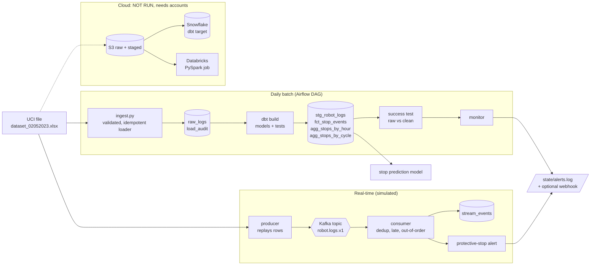

# Robot Log Pipeline

[](https://github.com/techeiFatima/robot-log-pipeline/actions/workflows/ci.yml)

A data pipeline for robot system logs. It answers **how often does the
robot stop itself, when, and under what conditions?**, and **alerts
within 5 minutes when it happens**.

> **About the data.** This project uses the public **UR3 CobotOps**
> dataset from the UCI Machine Learning Repository
> (<https://archive.ics.uci.edu/dataset/963/ur3+cobotops>). It **stands in
> for real robot system logs**. This project is **not affiliated with any
> company**. The real-time stream is a **simulation**: it replays the
> recorded file as if the robot were live.

## Architecture



All local storage is DuckDB: `cobot.duckdb` for the batch tables,
`stream.duckdb` for the stream.

## Status: what was built and what was run

| Part | Built | Run and verified here |
|---|---|---|
| Loader (`ingest.py`) | ✅ | ✅ real file; run twice = no duplicates; failure cases |
| dbt models + tests (DuckDB) | ✅ | ✅ `dbt build` PASS=37 on the real file |
| Success test (raw vs clean) | ✅ | ✅ PASS on the real file (numbers below) |
| Unit and integration tests | ✅ | ✅ pytest, plus 7 CI jobs on every pull request |
| Airflow daily DAG | ✅ | ✅ `airflow dags test` (success and failure runs); the long-running scheduler and UI were not run |
| Kafka stream (simulation) | ✅ | ✅ real Kafka 4.4.0 broker, full file replayed with injected disorder; Docker image tested in CI |
| Monitoring and alerts | ✅ | ✅ on real data; webhook tested against a local server only |
| S3, Snowflake, Databricks | ✅ code + config | ❌ **NOT RUN, needs accounts**. S3 tested on a mock; Snowflake target parses; the PySpark job ran on local Spark and matched dbt exactly |
| Stop-prediction model | Phase 11 | see [Prediction model](#prediction-model) |

## How to run (macOS or Linux, Python 3.13)

```bash
git clone https://github.com/techeiFatima/robot-log-pipeline.git
cd robot-log-pipeline
python3.13 -m venv .venv
source .venv/bin/activate
pip install -r requirements-dev.txt          # runtime + pytest + ruff + this package (-e .)
```

With miniconda, if `python3.13` is not on your PATH, run
`python -m venv .venv` from an environment whose `python --version` is 3.13.

Get the data (it is never committed):

```bash
mkdir -p data/raw
curl -L -o data/raw/ur3_cobotops.zip https://archive.ics.uci.edu/static/public/963/ur3+cobotops.zip
unzip data/raw/ur3_cobotops.zip -d data/raw
```

Run the batch pipeline:

```bash
python ingest.py                              # load every .xlsx in data/raw/ (safe to repeat)
python -m robot_pipeline.dbt_runner build     # models + dbt tests
python -m robot_pipeline.checks               # success test: raw vs clean
python -m robot_pipeline.monitor              # health checks -> state/alerts.log
python -m robot_pipeline.report               # every headline number below
```

Tests:

```bash
pytest                       # unit + integration tests (SYNTHETIC data only)
pytest -m "not integration"  # quick run, no dbt
```

More:
[Airflow](orchestration/README.md) ·
[Kafka stream](stream/README.md) ·
[Cloud (not run)](cloud/README.md) ·
[Alert runbooks](docs/runbooks.md) ·
[Data dictionary](docs/data_dictionary.md) ·
[One-page summary for non-engineers](docs/summary_for_non_engineers.md) ·
[Decisions](DECISIONS.md) ·
[Walkthrough](WALKTHROUGH.md)

## Data source

UR3 CobotOps, UCI Machine Learning Repository, dataset 963. The zip holds
one Excel file, `dataset_02052023.xlsx`: 7,409 rows × 24 columns, one
row per log line from a UR3 collaborative robot on 26 October 2022.
Columns: per-joint current, temperature and speed (6 joints), tool
current, cycle number, protective-stop flag and grip-lost flag.

## What profiling found (each checked by a query)

| # | Finding | How the pipeline handles it |
|---|---|---|
| 1 | `Timestamp` is text (VARCHAR), not a time type | parsed to `event_ts` (TIMESTAMP, UTC) |
| 2 | 863 timestamps are wrapped in stray `"` characters | stripped before parsing; `had_stray_quotes` keeps the evidence |
| 3 | One day, 08:17:21.847 to 15:36:06.580 UTC (7.31 h), but only 2.08 h of rows; median spacing 1.005 s; 3 gaps over 5 s, the longest 5.23 h | `seconds_since_previous`, `is_after_gap`; summaries report minutes actually recorded |
| 4 | 54 rows have no `Robot_ProtectiveStop` value and almost no sensor data | kept and labelled `stop_status = 'unknown'`; never dropped or guessed |
| 5 | `Robot_ProtectiveStop` is DOUBLE (7,077 × 0, 278 × 1, 54 NULL); `grip_lost` is BOOLEAN (243 true, 7,166 false) | `protective_stop` BOOLEAN + `stop_status` label; any other value → `invalid` → a test fails |
| 6 | Column `"cycle "` has a trailing space | renamed `cycle_id` |
| 7 | `Temperature_T0` breaks the `Temperature_J1..J5` pattern | renamed `temperature_j0` (assumed joint 0, documented as unconfirmed) |
| 8 | Column names mix styles | all snake_case |
| 9 | Current and speed go negative (meaning unconfirmed) | kept as delivered, documented |
| 10 | The 54 nearly empty rows still have a `grip_lost` value (always false) | kept as delivered, documented as an open question |
| + | Cycle numbers 224–227 and 229–233 each appear in two separate stretches of the log | `agg_stops_by_cycle.cycle_stretches` |
| + | In the 54 unknown rows, `Current_J0` is exactly 1.0 in 8 rows; every other sensor is NULL | documented |

## Results (real file, from `python -m robot_pipeline.report`)

- **108 protective-stop episodes** (278 stop rows): 1.58 s long on
  average, 11.07 s at most. That is **about 52 per recorded hour**.
- **By hour (UTC):**

  | Hour | Rows | Stop rows | Stop episodes | Stop rows % | Minutes recorded |
  |---|---|---|---|---|---|
  | 08:00 | 2,494 | 52 | 16 | 2.1 | 42.0 |
  | 09:00 | 375 | 23 | 5 | 6.1 | 6.3 |
  | 14:00 | 2,387 | 84 | 31 | 3.5 | 40.1 |
  | 15:00 | 2,153 | 119 | 56 | 5.6 | 36.1 |

- **Conditions:** 78 of 240 cycles had a stop. 10 % of the coolest third
  of cycles had a stop, against 61.3 % of the hottest third. Temperature
  and time of day rise together, so this is an association, not a
  cause. During stop rows, joint speed is near zero (that is the stop
  itself). Only 1 of the 108 episodes included a grip loss.

## The success test

> Every row the source marks as a stop appears as a stop in the clean
> table. Rows with unknown status are counted and reported separately,
> never dropped or guessed. Both counts are compared against the raw
> table on every run, not hardcoded.

It is enforced three ways: dbt singular tests
(`dbt/tests/assert_*.sql`, which fail `dbt build`), the report
`python -m robot_pipeline.checks` (exit code 1 on failure), and the same
check inside the Databricks PySpark job. Rows are matched one by one on
`(source_file, Num)`, so a stop moved to the wrong row also fails. Unit
tests prove the check fails on a lost, invented, swapped, dropped or
guessed row. Result on the real file:

```
Success test: raw_logs vs stg_robot_logs
  rows              raw   7409   clean   7409
  stop rows         raw    278   clean    278
  unknown status    raw     54   clean     54   (reported separately, never dropped or guessed)
  stops missing in clean 0, stops not in raw 0, invalid values 0
  RESULT: PASS
```

## Real-time stream and alerts (simulation)

- Full file replayed through a real Kafka 4.4.0 broker, with injected
  problems: 7,560 messages → **7,409 events, each stored once**. 151
  duplicates were ignored; 231 out-of-order events were kept and
  flagged, 80 of them late. Stops 278 = raw; unknown 54 = raw.
- **Protective-stop alert:** with the consumer running while the
  producer replayed 1,500 rows, 8 alerts went out for the 8 stop
  episodes, a median of 0.016 s and at most 2.2 s after the event was
  sent (target: 5 minutes).
- **Batch alerts** go to `state/alerts.log`, plus an optional webhook via
  `ALERT_WEBHOOK_URL`: data stopped arriving, row counts far below
  normal, failed checks, stream silent. On the real data,
  `hourly_rows_low` fires for 09:00–13:00 UTC, the recording gap.

## Prediction model

*Added in Phase 11.*

## Skills this project shows

Python · SQL · dbt (models, tests, docs, cross-database macros) · DuckDB ·
Snowflake (second dbt target, not run) · Databricks / PySpark (run on
local Spark, not on Databricks) · AWS S3 (boto3, tested on moto) ·
Airflow · Kafka · Git (one PR per phase) · code review (every PR reviewed
by a bot; findings fixed or answered) · unit testing (pytest) · CI/CD
(GitHub Actions) · log-based pipelines · real-time event streams · data
models · monitoring and alerting · data-quality checks · documentation.

## Project layout

```
ingest.py                     loader command line
robot_pipeline/               Python package: loader, checks, monitor, alerts, report
  stream/                       Kafka producer, consumer, store, stop alerts
  cloud/                        S3 upload/download
dbt/                          dbt project: models, tests, macros, profiles (DuckDB + Snowflake)
orchestration/dags/           Airflow DAG
stream/                       Kafka docker-compose + how-to
cloud/                        Snowflake SQL, Databricks bundle + PySpark job, IAM policies
docs/                         runbooks, data dictionary, non-engineer summary
tests/                        pytest suite (SYNTHETIC data only)
.github/workflows/ci.yml      CI: lint, tests, dbt build, Airflow, Kafka, Spark, S3 mock
```
